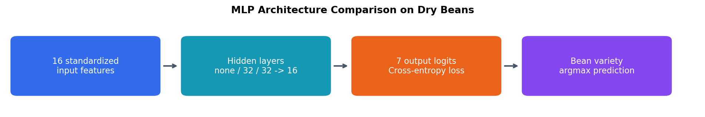

# Dry Bean Classification

I compared multilayer perceptrons for classifying seven bean varieties from 16 measured features.

## What I did

- Split the data before fitting the feature scaler.
- Implemented three PyTorch architectures: a linear classifier, one hidden layer, and two hidden layers.
- Compared accuracy, macro precision, recall, F1, training loss, and parameter counts.
- Investigated the effect of training duration using the selected architecture.

## Results

| Architecture | Parameters | Test accuracy | Macro F1 |
|---|---:|---:|---:|
| Linear classifier | 119 | 91.99% | 0.9322 |
| One hidden layer | 775 | 92.32% | 0.9337 |
| Two hidden layers | 1,191 | 92.18% | 0.9333 |

The one-hidden-layer model performed best in the architecture comparison. Its epoch study reached 92.66% accuracy after 25 epochs, compared with 92.29% after 10 and 92.32% after 50. These comparisons reuse the coursework test split and are exploratory.

## What I learned

Extra depth and longer training did not automatically improve performance. Fitting preprocessing only on training data prevents information from the evaluation split entering the feature transformation. Macro metrics complement accuracy when comparing class performance.

[View the notebook](dry_bean_classification.ipynb)
