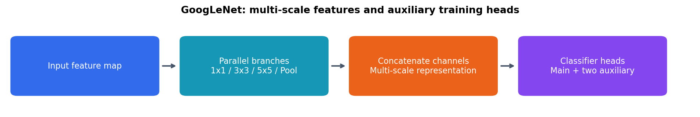
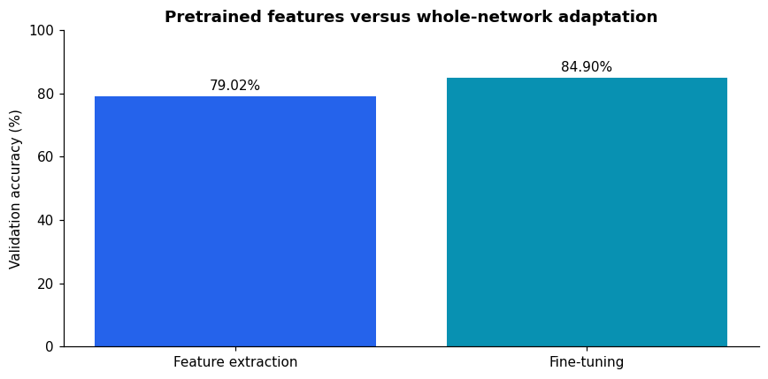

# GoogLeNet Transfer Learning on Flowers102

I adapted an ImageNet-pretrained GoogLeNet to classify 102 flower categories and compared feature extraction with full fine-tuning.

## What I did

- Used the official Flowers102 training and validation splits, with 1,020 images each.
- Replaced the main and auxiliary classifiers with 102-class outputs.
- Trained the classification heads with a frozen backbone, including frozen batch-normalization statistics.
- Fine-tuned the full network with a smaller learning rate.
- Used weighted auxiliary losses during training and selected checkpoints using validation accuracy.
- Visualized the Inception structure, example images, training curves, and class performance.

## Results

| Strategy | Best validation accuracy | Selected epoch |
|---|---:|---:|
| Feature extraction | 79.02% | 10 |
| Fine-tuning | 84.90% | 10 |

Each strategy trained for 10 epochs on a Tesla T4 GPU. The selected epoch maximized validation accuracy. Results describe validation performance; the official test split was not evaluated. Fine-tuning improved the best validation result in this run. The strategies also use different learning rates.

## What I learned

Feature extraction and fine-tuning update different parts of a pretrained model. Freezing parameters alone does not freeze batch-normalization running statistics. Auxiliary classifiers support training, while inference uses the main classifier. Training and validation loss comparisons must refer to the same main-head objective.

[View the notebook](googlenet_transfer_learning.ipynb)

Torchvision does not provide pretrained weights for the auxiliary branches. In the feature-extraction experiment, only their final `fc2` classifiers are updated; the rest of those branches remain fixed.
