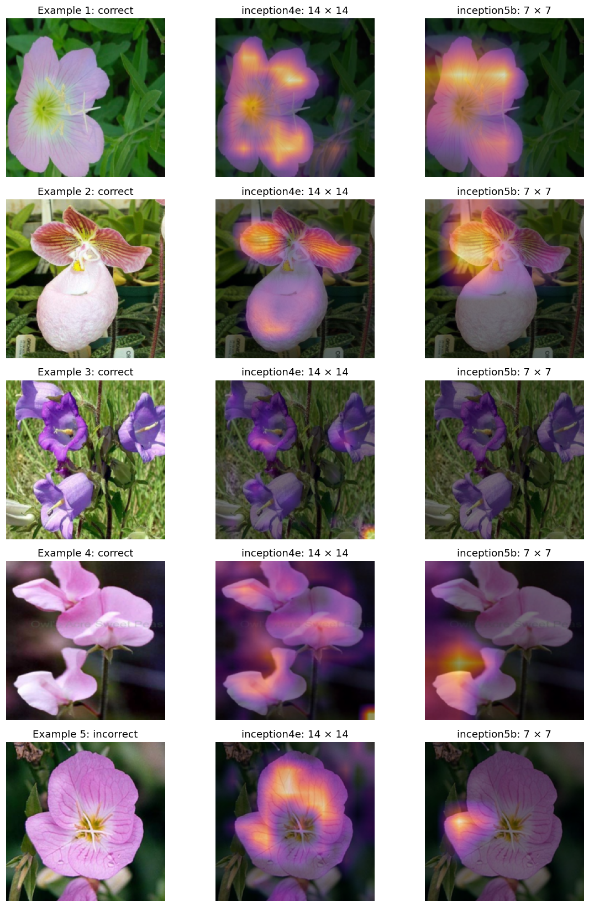
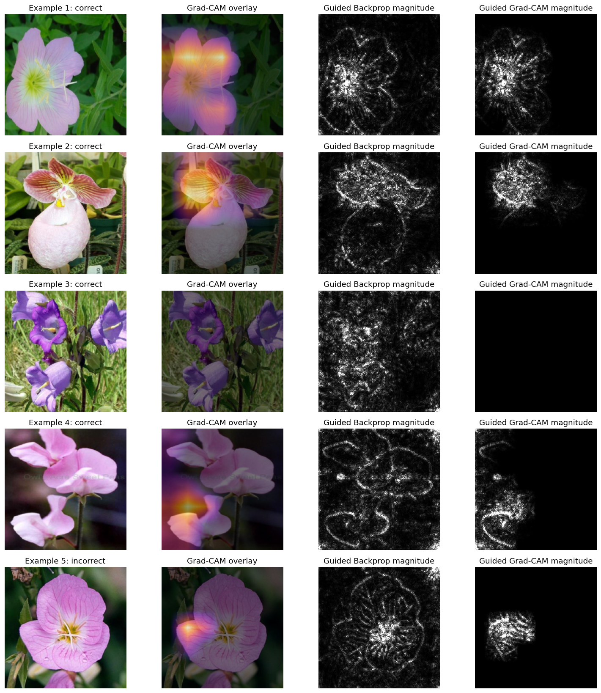

# Visual Explanations with Grad-CAM

I studied class-specific explanations for a fine-tuned GoogLeNet image classifier as part of my Deep Learning coursework.

## What I did

- Fine-tuned ImageNet-pretrained GoogLeNet on real Oxford Flowers102 images, using five warm-up epochs and 25 fine-tuning epochs.
- Preserved the official training, validation, and test partitions, and selected weights using validation loss.
- Implemented Grad-CAM from target-logit gradients, with temporary hooks that are removed after each computation.
- Compared inception4e and inception5b localization, then contrasted true-class and predicted-class explanations for a misclassified image.
- Corrected GoogLeNet's functional ReLU handling for Guided Backpropagation and compared Guided Grad-CAM with Captum's implementation.
- Explained four correct predictions from different classes and one incorrect prediction.

## Results

| Measurement | Result |
|---|---:|
| Full-test accuracy | 84.00% |
| Full-test macro F1 | 0.8270 |
| Validation-selected epoch | 30 |
| Training / validation / test images | 1,020 / 1,020 / 6,149 |
| Completed training epochs | 30 |
| inception4e native map | 14 × 14 |
| inception5b native map | 7 × 7 |
| ReLU conversion: maximum logit difference | 0.00e+00 |
| Guided Grad-CAM: maximum reference difference | 2.91e-10 |

The notebook completed on a Tesla T4. Both custom Grad-CAM layer calculations matched Captum's reference implementation within the notebook's tolerances. The ReLU conversion preserved evaluation predictions. These checks establish implementation consistency; they do not measure explanation faithfulness.

The third Guided Grad-CAM display is nearly blank even though the prediction is correct. This is a limitation of the displayed explanation, and it is retained rather than treated as evidence that every correct prediction has a clear localization map.

## What I learned

Real images and trained weights are necessary before interpreting model behavior. A 7 × 7 activation map stays coarse even when bilinear interpolation produces a smooth 224 × 224 display. Comparing target classes changes which output is explained, without changing the image; this is not an image-based counterfactual experiment.

Captum requires explicit ReLU modules for Guided Backpropagation. I converted the active convolution-block ReLUs on a copy of the trained model and checked unchanged logits. Guided Grad-CAM multiplies raw guided gradients by the upsampled positive Grad-CAM; normalization is applied only for display.

The grayscale guided displays show absolute magnitude and discard sign. Each heatmap is normalized independently, so brightness is not comparable as an absolute attribution across images or classes. The five selected examples are illustrative, and visual sharpness does not prove causal importance or explanation quality. I do not infer the cause of a classification error from a heatmap alone.

The training procedure uses mixup, label smoothing, cosine decay, and a single seed. Torchvision's auxiliary branches are randomly initialized, fixed during warm-up, and trained during fine-tuning. These results do not measure variation across repeated seeds.

[Notebook](grad_cam_visual_explanations.ipynb) · [Grad-CAM paper](https://arxiv.org/abs/1610.02391) · [Captum Guided Backpropagation](https://captum.ai/api/guided_backprop.html) · [Captum Guided Grad-CAM](https://captum.ai/api/guided_grad_cam.html)
