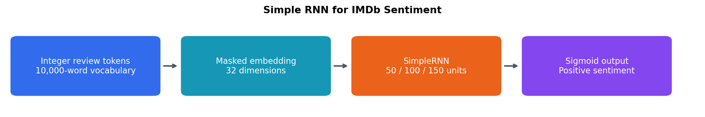

# Simple RNN for IMDb Sentiment

I trained a recurrent neural network to classify movie reviews as positive or negative.

## What I did

- Prepared token sequences using a 10,000-word vocabulary, explicit padding and truncation, and an embedding layer.
- Trained a SimpleRNN baseline with 100 hidden units.
- Compared maximum review lengths of 250, 500, and 750 tokens.
- Compared 50, 100, and 150 hidden units and verified their parameter counts.
- Explained recurrent processing, backpropagation through time, and vanishing or exploding gradients.

## Results

The baseline reached **78.47% test accuracy** after three epochs.

| Maximum review length | Test accuracy |
|---|---:|
| 250 tokens | 71.49% |
| 500 tokens | 77.67% |
| 750 tokens | 74.24% |

| Hidden units | Parameters | Test accuracy |
|---|---:|---:|
| 50 | 324,201 | 78.89% |
| 100 | 333,401 | 78.81% |
| 150 | 347,601 | 67.64% |

Longer sequences and larger hidden states did not consistently improve accuracy. Repeated nominally identical configurations differed despite seed resets; these are single-run exploratory comparisons.

## What I learned

Longer sequences preserve more text but require more recurrent computation. Hidden-state size changes capacity and increases recurrent parameters approximately quadratically. Padding masks prevent artificial padding tokens from being treated as review content. The test-set comparisons are exploratory because the coursework reuses the test set across configurations.

[View the notebook](imdb_rnn_sentiment.ipynb)
