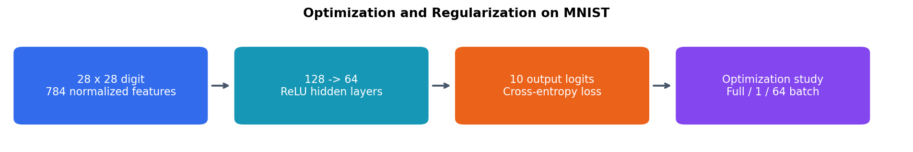

# Optimization and Regularization on MNIST

I explored optimization and regularization while classifying handwritten digits with a neural network.

## What I did

- Compared full-batch, stochastic, and mini-batch gradient descent.
- Measured loss and execution time under a shared runtime configuration.
- Compared dropout settings using consistent evaluation-mode training and validation losses.
- Implemented validation-based early stopping and restoration of the lowest-loss checkpoint.
- Compared the stopped model with a fixed-duration reference from matched initial weights.

## Results

| Optimization method, 20 epochs | Final training loss | Training time |
|---|---:|---:|
| Full batch | 2.3057 | 14.83 s |
| Stochastic, batch size 1 | 0.0143 | 765.96 s |
| Mini-batch, batch size 64 | 0.1445 | 26.75 s |

These are epoch-budget comparisons, not equal-update comparisons. Timing was measured on Kaggle using one CPU thread.

At 30 epochs, dropout probabilities 0.0, 0.2, and 0.5 produced validation losses of **0.6674**, **0.8492**, and **1.8550**. Heavier dropout did not improve this experiment at the allotted training duration.

Early stopping did not trigger within 100 epochs. The best validation checkpoint occurred at epoch 99 and achieved **93.34% test accuracy**, compared with **93.33%** for the final 100-epoch reference. No training time was saved by early stopping in this run.

## What I learned

Batch size changes update frequency and computational cost. Dropout behaves differently during training and evaluation, so loss comparisons must use consistent modes. Checkpoint selection and patience are distinct: the best checkpoint can occur even when early stopping never triggers.

[View the notebook](mnist_optimization_regularization.ipynb)
