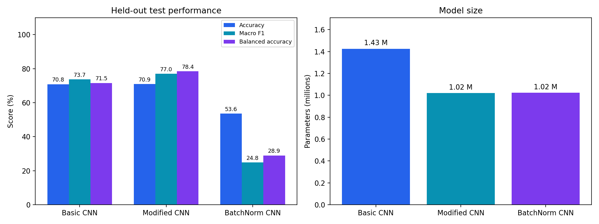
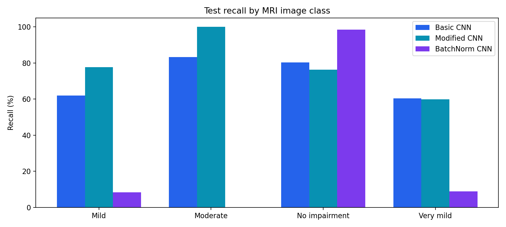
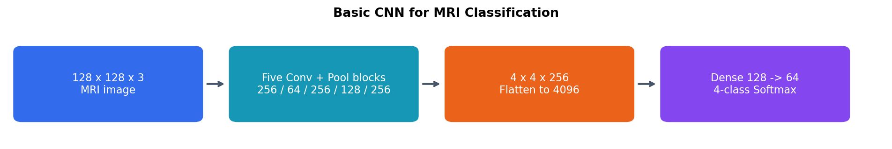
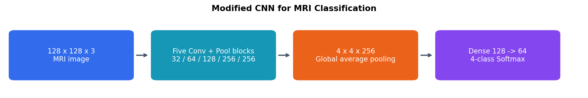

# CNNs for MRI Image Classification

I compared three convolutional networks for four-class MRI image classification as part of my coursework.

## What I did

- Implemented the specified five-block CNN, a smaller model with progressive filters and global average pooling, and a model with batch normalization.
- Used a stratified validation partition within the training data and kept the provided test split for final evaluation.
- Applied augmentation during training and evaluated original images without augmentation.
- Investigated failed learning with small training-only diagnostics before repeating full training.
- Compared learning curves, parameter counts, confusion matrices, and individual predictions.

## Experimental settings

All variants use the same image partitions, augmentation, batch size of 8, and a 50-epoch budget. The lowest-validation-loss checkpoint is evaluated on the test split.

| Model | Initialization | Initial learning rate |
|---|---|---:|
| Basic CNN | He initialization for ReLU layers | 0.0003 |
| Modified CNN | He initialization for ReLU layers | 0.0001 |
| BatchNorm CNN | He initialization | 0.0001 |

Learning rate is reduced when validation loss stalls. Optimization settings differ between models, so the comparisons do not isolate architecture alone. Each score comes from one training run; variation across random seeds was not measured.

## Results

The original basic and modified networks collapsed to one-class predictions. Training-only diagnostics motivated changes to initialization and learning rate before these full runs.

| Model | Test accuracy | Macro F1 | Balanced accuracy | Selected epoch | Parameters |
|---|---:|---:|---:|---:|---:|
| Basic CNN | 70.84% | 0.7365 | 71.54% | 37 | 1,425,540 |
| Modified CNN | 70.91% | 0.7699 | 78.43% | 50 | 1,019,908 |
| BatchNorm CNN | 53.56% | 0.2482 | 28.94% | 17 | 1,022,692 |

All three models completed 50 epochs on Tesla T4 GPUs. Each test result uses the checkpoint with the lowest validation loss. Modified CNN achieved the highest macro F1 in these runs. Initial learning rates, dropout, and architecture differ, so this comparison does not isolate a single design choice.

The BatchNorm model was strongly biased toward No Impairment and had much weaker macro F1 and balanced accuracy. Adding normalization and dropout did not improve performance in this run.

The test split contains 179 Mild, 12 Moderate, 640 No Impairment, and 448 Very Mild images. The very small Moderate group makes its recall particularly uncertain.

## What I learned

Loss and prediction distributions can reveal optimization failure that accuracy alone hides. Global average pooling reduces the classifier size, while batch normalization adds running statistics whose training and evaluation behavior differs. The BatchNorm variant also changes dropout, so its performance difference cannot be attributed only to normalization.

These experiments use image-level partitions. Patient-level independence is not established by the dataset's folder structure.

- [Basic CNN](basic-cnn) — notebook, results, and learning
- [Modified CNN](modified-cnn) — notebook, results, and learning
- [CNN with batch normalization](batchnorm-cnn) — notebook, results, and learning

