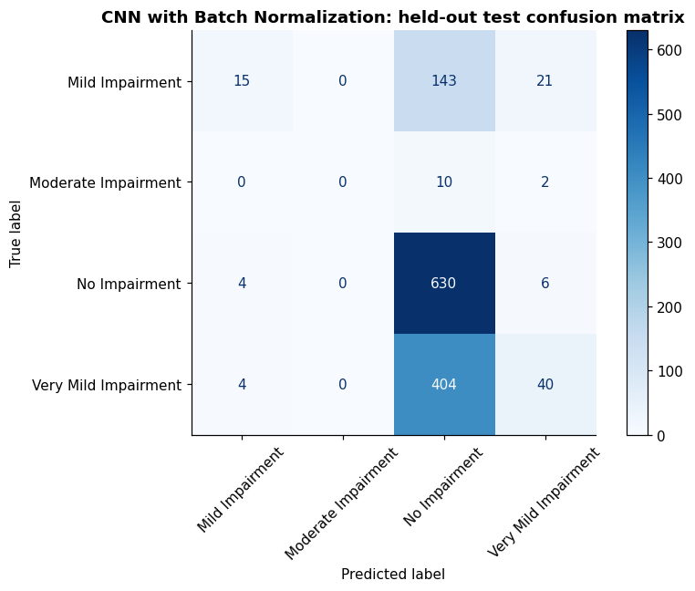

# CNN with Batch Normalization for MRI Classification

I completed this four-class MRI image classification experiment as part of my Deep Learning coursework.

## What I did

Added batch normalization before ReLU activations in convolution and dense blocks, with global average pooling and dropout.

I trained on 128 × 128 RGB images with augmentation, batch size 8, and a 50-epoch budget. The initial Adam learning rate was 0.0001, with He initialization and learning-rate reduction when validation loss stalled. I selected the checkpoint using validation loss and reserved the provided test images for evaluation.

Image batches are prefetched using four loader threads. Augmentation draws and GPU operations can vary between reruns despite the fixed seed.

## Results

| Measurement | Result |
|---|---:|
| Test accuracy | 53.56% |
| Test macro F1 | 0.2482 |
| Test balanced accuracy | 28.94% |
| Test cross-entropy loss | 0.9278 |
| Training accuracy without augmentation | 73.65% |
| Validation-selected epoch | 17 |
| Parameters | 1,022,692 |

The model completed 50 epochs on a Tesla T4 GPU. Partitions contain 8,192 training, 2,048 validation, and 1,279 test images. The test set is imbalanced; macro F1 and balanced accuracy complement overall accuracy.

The model predicted No Impairment for 1,187 of 1,279 test images (92.81%). Recall was 98.44% for that class, but only 8.38% for Mild and 8.93% for Very Mild; none of the 12 Moderate images were correctly classified. This is poor class discrimination despite the overall accuracy exceeding 50%. Batch normalization did not improve this experiment. Small-batch running statistics and the additional dropout are possible factors, but this run does not establish a cause.

## What I learned

Batch normalization uses batch statistics during training and running statistics during evaluation. Small batches and dropout can affect validation behavior.

I used learning curves, a confusion matrix, class metrics, and prediction examples to examine the model beyond overall accuracy. The partitions are at image level; patient-level independence is not established.

[Notebook](batchnorm_cnn.ipynb) · [Comparison of the three CNNs](../README.md)

