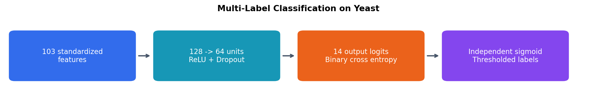

# Multilabel Yeast Classification

I built a neural network that predicts multiple functional labels for each yeast sample rather than choosing one mutually exclusive class.

## What I did

- Prepared 103 input features and 14 binary targets across 2,417 samples.
- Used separate training, validation, and test partitions, fitting imputation and scaling on training data.
- Trained a sigmoid-output network with binary cross-entropy.
- Compared Hamming loss, exact-match accuracy, micro F1, and macro F1.
- Selected a probability threshold using validation micro F1 and visualized label prevalence and co-occurrence.

## Results

| Test metric | Threshold 0.50 | Validation-selected threshold 0.25 |
|---|---:|---:|
| Hamming loss | 0.2090 | 0.2373 |
| Exact-match accuracy | 19.28% | 12.95% |
| Micro F1 | 0.6434 | 0.6572 |
| Macro F1 | 0.4371 | 0.4763 |

## What I learned

Threshold selection changes the precision–recall balance: the lower threshold improved F1 but worsened Hamming loss and exact-match accuracy. Multilabel evaluation requires several metrics because they measure different aspects of prediction quality. The loss curves also show why declining training loss alone does not establish good generalization.

[View the notebook](multilabel_yeast_classification.ipynb)
