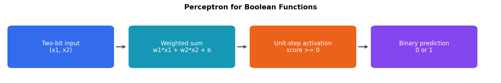

# Perceptron and Boolean Functions

I implemented a perceptron from scratch as part of my Deep Learning coursework and investigated which Boolean functions a single linear classifier can represent.

## What I did

- Trained perceptrons on AND and OR truth tables and tracked weight updates and classification errors.
- Compared learning rates and visualized the learned decision boundaries.
- Investigated XOR and explained its lack of linear separability.

## Results and learning

AND and OR converged to valid separating boundaries. XOR did not converge to a solution because a single line cannot separate its classes. With zero initialization, a constant positive learning rate scales the perceptron weights in exact arithmetic; observed convergence differences can arise from floating-point behavior.

The visualizations connect the update rule to the geometry of classification and show why some problems require multiple layers.

[View the notebook](perceptron_boolean_functions.ipynb)
