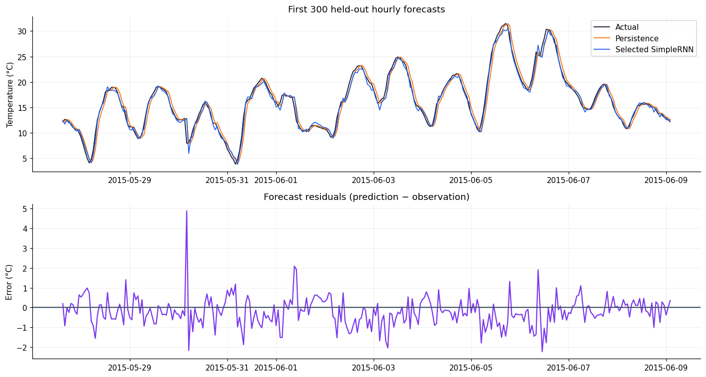
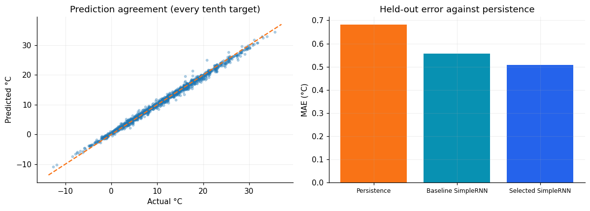

# Hourly Temperature Forecasting with a SimpleRNN

I explored recurrent forecasting and backpropagation through time using Jena Climate measurements as part of my Deep Learning coursework.

## What I did

- Cleaned invalid wind readings and averaged ten-minute observations into hourly measurements.
- Built windows ending at hour t to predict temperature at t + 1, and verified the alignment explicitly.
- Used chronological 70% training, 10% validation, and 20% test periods, with scaling fit only on the training period.
- Compared 6–96 hours of history and 16–128 hidden units with a five-epoch training budget per configuration.
- Reconstructed learned recurrences and checked hidden-state gradients for 12-, 48-, and 96-hour histories.
- Selected settings using validation MAE, then compared held-out forecasts with a persistence baseline.

## Results

| Model | History (hours) | Hidden units | Parameters | Test MAE (°C) | Test MSE (°C²) |
|---|---:|---:|---:|---:|---:|
| Persistence | 1 | 0 | 0 | 0.6813 | 0.8986 |
| Baseline SimpleRNN | 24 | 32 | 1,217 | 0.5556 | 0.5327 |
| Selected SimpleRNN | 12 | 128 | 17,153 | 0.5086 | 0.4592 |

The selected model uses **12 hours** of history and **128 hidden units**. Its checkpoint came from epoch 4. The held-out period contains 14,026 hourly targets, from 2015-05-27 15:00:00 through 2017-01-01 00:00:00.

The selected RNN improved on persistence in this run.

## What I learned

A valid forecast must use only information available before its target. Target standardization helps optimization, while errors in °C retain their meaning. More history and a larger hidden state do not guarantee better predictions within a short training budget. Persistence is an essential reference for a slowly varying signal such as hourly temperature.

The final settings combine two validation sweeps; this is a sequential search rather than a complete joint grid. Validation and test windows can use earlier observations as context, but test targets do not select settings. Five epochs and one seed limit conclusions about architecture quality. Gradient attenuation or amplification on one batch does not establish the cause of forecast errors, and measured runtime includes tracing overhead.

[Notebook](rnn_temperature_forecasting.ipynb) · [TensorFlow time-series forecasting reference](https://www.tensorflow.org/tutorials/structured_data/time_series)
