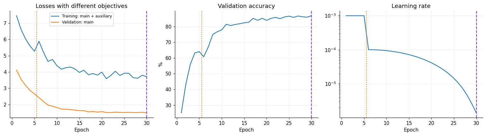
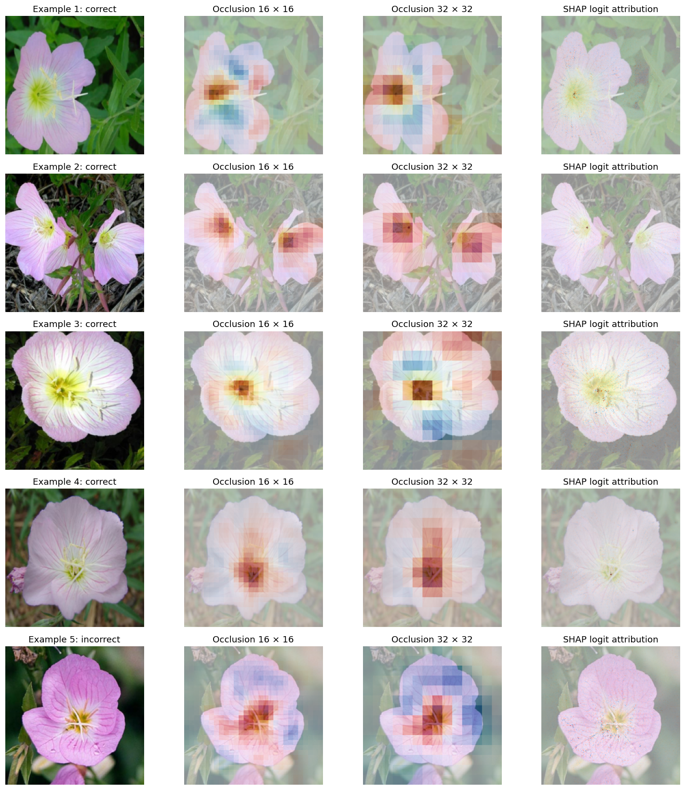

# Explaining GoogLeNet Flower Predictions

I studied how a deep image classifier responds to changes in colors, internal features, and spatial regions as part of my Deep Learning coursework.

## What I did

- Fine-tuned pretrained GoogLeNet on Oxford Flowers102, with five frozen-backbone warm-up epochs and 25 fine-tuning epochs.
- Used augmentation, label smoothing, mixup, and cosine learning-rate decay.
- Kept the official training, validation, and test partitions separate, and selected the checkpoint using validation loss.
- Compared RGB-channel permutation, ablation of all 1,024 inception5b channels, two occlusion patch sizes, and SHAP expected gradients.
- Explained four correct predictions and one incorrect prediction, using 50 training images as the SHAP background.

## Results

| Measurement | Result |
|---|---:|
| Full-test accuracy | 83.95% |
| Full-test macro F1 | 0.8276 |
| Selected checkpoint epoch | 30 |
| Training / validation / test images | 1,020 / 1,020 / 6,149 |
| Training epochs | 30 |
| SHAP samples per image | 200 |

The notebook completed on a Tesla T4 GPU. Five hand-selected explanation examples illustrate behavior; they do not estimate the classifier's accuracy. RGB permutations use 20 repetitions, and their error bars describe variability across those permutations rather than uncertainty across independent datasets.

All five selected images belong to the same true flower class (class 1 in the plots), so this is a within-class illustration. Blue-channel permutation produced the largest mean true-class probability drop (0.1746) on these examples. Signed occlusion–SHAP spatial rank agreement was weak (mean 0.0113), while the two occlusion scales agreed more strongly (mean 0.6612). The largest SHAP additivity approximation residual was 1.72 logit units with 200 samples; these maps remain approximate.

## What I learned

Permutation and feature ablation are different interventions. Occlusion measures a predicted-class probability change, while SHAP here attributes the predicted logit relative to training backgrounds. Signed maps preserve both support and opposition to a prediction. The chosen target, background, patch size, and approximation budget affect explanations, so similar-looking heatmaps do not prove causal importance or explanation faithfulness.

Freezing a pretrained backbone also requires freezing batch-normalization running statistics. Torchvision's auxiliary branches are not pretrained; their hidden layers stay fixed during warm-up and train during fine-tuning. Accuracy comes from one run, and seed-to-seed variability was not measured.

[Notebook](vision_model_explainability.ipynb) · [SHAP GradientExplainer reference](https://shap.readthedocs.io/en/stable/generated/shap.GradientExplainer.html) · [Oxford Flowers102](https://www.robots.ox.ac.uk/~vgg/data/flowers/102/)
